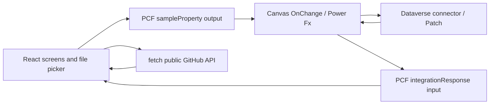

# Single-PCF integration lab — version 0.0.7

One React PCF hosts Home, Bulk upload and Integration lab. Its source is split into modules and compiled into one component bundle.

## How the app works



`CmsUploadDemo/index.ts` implements the PCF lifecycle. `init` captures `notifyOutputChanged` and tracks container resizing. `updateView` renders the React root with the latest response and allocated height. React dispatches JSON; `getOutputs` exposes it as `sampleProperty`. Canvas `OnChange` runs `Integration-OnChange.pfx` and writes `varIntegrationResponse`, bound back to `Coalesce(varIntegrationResponse, "")`.

Requests carry `kind`, `version`, `requestId`, `service`, `operation` and `payload`. React accepts a response only for its pending request ID and service. Only one request runs at a time. The 30-second UI timeout does not cancel Canvas writes. Successful files remain saved if another file fails; inspect the results/backend before retrying to avoid duplicate records. Navigation keeps the lab mounted so results and pending state survive changing screens.

The manifest declares the React platform library, CSS, request/response properties and external domain `api.github.com`. CSS is scoped to `.xp-app`. The tracked PCF height constrains the root and gives the main area/sidebar vertical scrolling. Canvas places `CmsUploadDemo1` on `Screen1` with width/height `Parent.Width`/`Parent.Height` and zero position defaults.

Canvas PCF does not support Dataverse `context.webAPI` or custom authentication. Authenticated services use Canvas connectors or flows; no access tokens or secrets are embedded in React. The public GitHub request uses anonymous `fetch` with credentials omitted. External-service usage makes this PCF a premium control; the manifest declares it accordingly.

Official references: [Canvas PCF limitations](https://learn.microsoft.com/en-us/power-apps/developer/component-framework/limitations), [external service declaration](https://learn.microsoft.com/en-us/power-apps/developer/component-framework/manifest-schema-reference/external-service-usage).

## Implemented tests

| Feature | Implementation | Evidence so far |
| --- | --- | --- |
| Canvas round trip | React output → Power Fx echo → React input | User confirmed Success in Canvas Preview |
| Public REST API | GitHub REST lists up to 10 entries from Microsoft's PowerApps-Samples/component-framework directory | Real Chrome HTTP 200 and returned sample names; target Canvas Preview confirmation pending |
| Dataverse read | Refresh and read up to 10 records from PCF Probe Files | Formula validated; user reports app working; independent PAC read finds 3 batch records |
| Dataverse write | Patch a dedicated test record, return its actual ID | Formula validated and server state verified; runtime test pending |
| Batch file contents | Encode selected files as Base64; Canvas Patch one record per file, return per-file IDs/errors | 3 real file records independently read through PAC; stored Base64 decoded and byte lengths match selected file sizes |
| Power Automate | Reserved test button | No flow configured or run verified |
| SharePoint | Reserved read/write buttons | No site/list/connection configured or operations verified |

The actual API endpoint is `https://api.github.com/repos/microsoft/PowerApps-Samples/contents/component-framework`. There is a 15-second HTTP abort timer, HTTP error handling and response-shape validation. GitHub can rate-limit anonymous requests. APIs requiring credentials should instead use a custom connector or a flow.

## Dedicated Dataverse table

`DataverseProbe/Program.cs` created and published user-owned `xcl_pcfprobefile` in the existing demo solution `XCL_canvas_pcf_lab`. It verifies the organization and solution IDs before changing metadata. Its setup creates no file records. The user added **PCF Probe Files** to Canvas; MCP confirms it is a writable CdsNative data source and discovers its schema.

| Logical column | Purpose |
| --- | --- |
| xcl_pcfprobefileid | Record GUID |
| xcl_name | Primary name |
| xcl_batchid | Correlated request/batch ID |
| xcl_filename | Original file name |
| xcl_mimetype | MIME type |
| xcl_contentbase64 | Actual Base64-encoded file contents, memo column |
| xcl_studentid | Reserved for subsequent photo integration |

The lab permits up to 10 files, 128 KB each and 384 KB total before Base64 encoding. This is a small-file feasibility test using a text column, not a native Dataverse File column. Production photo storage should use a native File/Image column or SharePoint and a suitable upload service. The original **Bulk upload photos → Send** remains simulated and emits metadata without photo bytes.

`Integration-OnChange.pfx` is the live handler, also present in `canvas/Screen1.pa.yaml`. Validation passes. App Checker reports one medium performance advisory for per-file `Patch` inside `ForAll`; this is deliberate for individual error results with a maximum of 10 files. A production high-volume uploader needs queueing/batched server processing rather than extending this loop.

## Runtime checklist

1. Save the app, leave Studio, reopen and accept a code-component update if shown. Confirm **Batch files → Dataverse** is visible.
2. Preview → Integration lab → REST API **Read test**. Expect HTTP 200 and actual sample names.
3. Dataverse **Write test**, then **Read test**. Expect a real record GUID and the saved record.
4. Select `test-files/probe-alpha.txt` and `test-files/probe-beta.txt` in Batch files, then save. Expect two individual record GUIDs.
5. Independently query Dataverse by returned batch ID, decode `xcl_contentbase64` and compare bytes with the two originals. UI Success alone is not this independent verification.
6. Save/publish the Canvas app after reviewing the changes.

Read-only verification using the SDK helper (interactive Microsoft sign-in may be required):

```powershell
dotnet run --project deployment\DataverseProbe -- --verify <returned-request-id> deployment\test-files
```

This checks the demo organization/solution, fetches that batch, compares decoded contents byte-for-byte with local originals, and reports GUIDs, lengths and SHA256 hashes. It does not print file contents or write records. Without arguments the same helper performs table setup instead, so use the explicit `--verify` arguments for verification. The helper targets this demo only; a company environment needs its own verified configuration.

The user Preview attempt reported a Patch network error saying the data source was not configured correctly. Removing/re-adding the table then reported "The datasource is corrupted". Restarting Studio and temporarily removing every Power Fx reference to the table did not resolve adding it. The user also reports both standard Accounts and PCF Probe Files fail to add in a separate blank Canvas session. This broadens the investigation to Canvas authoring/connection/session behavior; it does not establish corruption of the custom table.

During diagnosis PAC read the table successfully but found no records, confirmed the user has System Administrator, and reported both Dataverse connections Connected. Persistence was unverified at that stage. A temporary echo handler paused Dataverse during diagnosis. A subsequent screenshot showed that handler was still active, rather than a new connector failure. The user was then supplied the complete handler inline and via clipboard. The user subsequently confirmed PCF Probe Files could be added with Coauthoring disabled. This identifies a working way to add the data source in this environment, without establishing a general platform defect. Coauthoring remained disabled for the successful runtime test. MCP requires Coauthoring, so the handler was supplied for manual restoration in Studio: CmsUploadDemo1 > OnChange > Integration-OnChange.pfx > Save > Preview. The existing integrationResponse binding remains in place. The user subsequently reported the app works. Independent PAC reads confirmed batch `probe-1791712551925-12ycd0` has 3 real records. Stored Base64 decodes to 90,635, 54,944 and 28,975 bytes, matching the user-selected file sizes. IDs and SHA256 hashes are in `evidence/dataverse-batch.json`; original files were not opened for a hash comparison.

The SDK helper supports read-only `--inspect` to compare published custom-table metadata with Accounts, and optional `--device-login` for Microsoft device-code authentication when interactive SDK sign-in does not work. This uses a fresh in-memory MSAL session and never prints or persists access tokens. The metadata inspection has not completed because sign-in failed; the device-code attempt was cancelled.

PCF manifest, TypeScript and ESLint checks pass. Chrome tests cover scroll/mobile layout, stale/malformed/duplicate responses, pending request locking, navigation, timeouts, actual public API fetch, HTTP failure handling and selected file encoding. Browser fixtures do not prove live Dataverse writes.

## Saved image preview (0.0.8)

Integration lab now includes Saved images in Dataverse > Load saved images. The new read-images operation refreshes the table, filters records with a file name, sorts by createdon descending and returns the latest 3 files. This is a bounded demo view, not pagination. JPEG/PNG contents are decoded to temporary Blob URLs, displayed with their file names and downloadable; URLs are revoked on refresh/unmount. Each preview is limited to 128 KB. The test log lists IDs/names without retaining the Base64 body.

Coauthoring remains disabled. Paste the complete updated Integration-OnChange.pfx into CmsUploadDemo1.OnChange, preserve integrationResponse = Coalesce(varIntegrationResponse, ""), Save and reopen Studio to load PCF 0.0.8. Preview > Integration lab > Load saved images. The updated formula has not yet been validated in live Studio or exercised against its connector. Canvas YAML in this repo reflects the intended formula, not a fresh live sync.

TypeScript, manifest validation, ESLint and production deployment build passed. A Chrome fixture verified three decoded PNG previews, download filename, empty refresh and malformed image handling. These fixtures do not establish that the new Canvas read-images formula succeeds against Dataverse. PCF 0.0.8 was imported and published successfully to the demo org.
